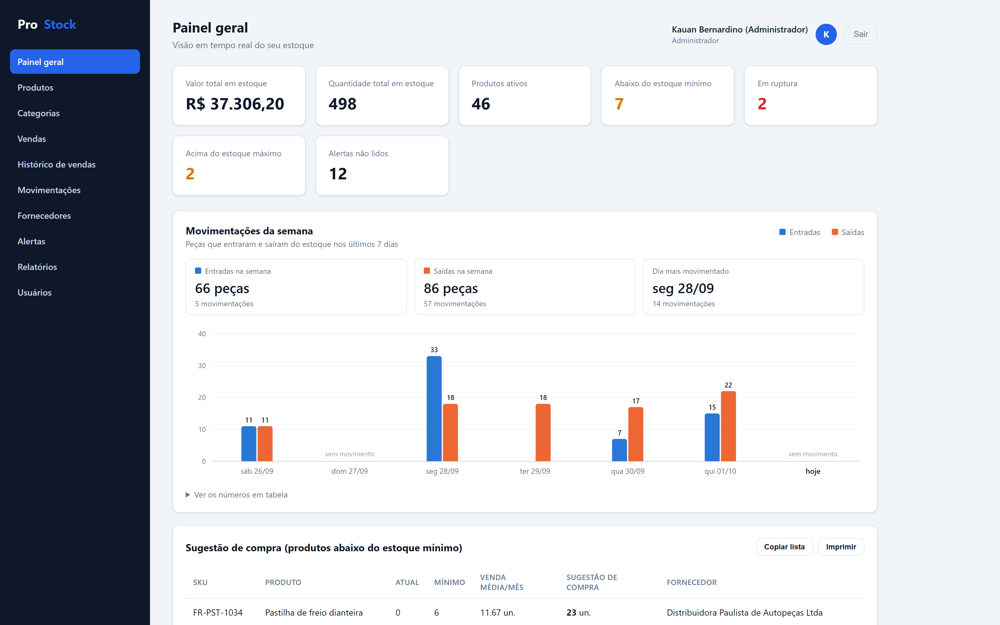
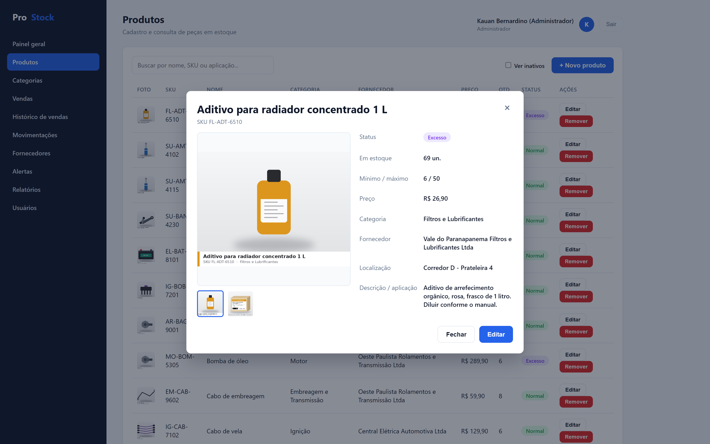
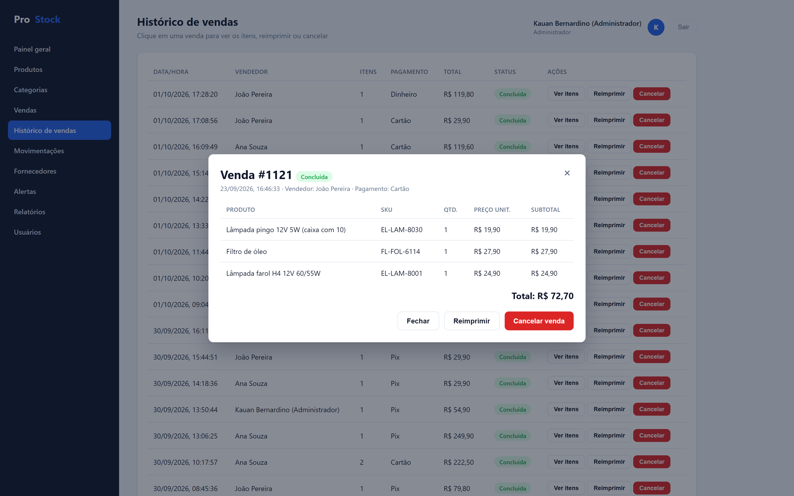
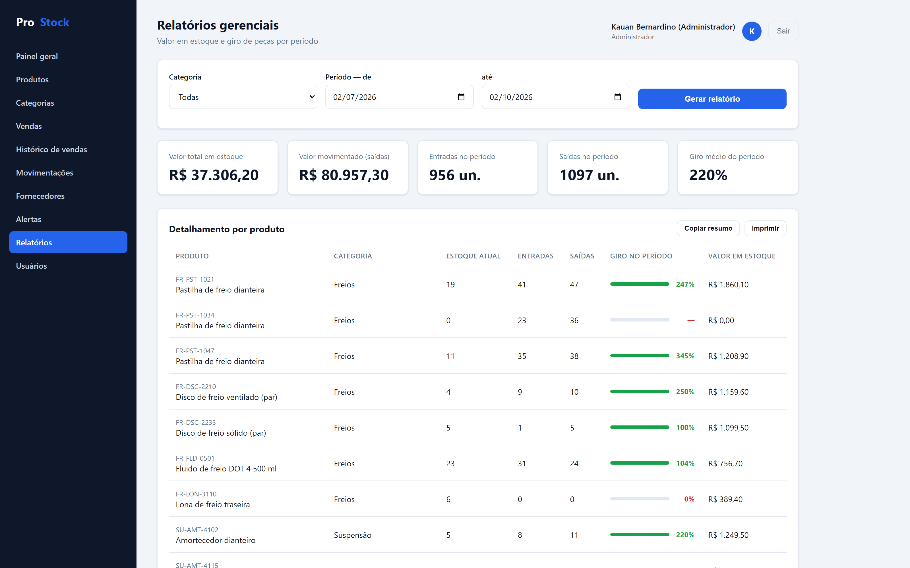
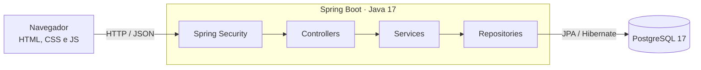

# ProStock

Sistema web de gestão de estoque para lojas de autopeças. Controla produtos e movimentações, gera alertas de estoque, sugere compras com base nas vendas recentes e tem venda de balcão com Pix, cartão ou dinheiro.

Trabalho de Conclusão de Curso em Análise e Desenvolvimento de Sistemas (FEMA, 2026), feito a partir da rotina de uma loja de autopeças.

   

| Painel geral | Detalhes do produto |
|---|---|
|  |  |
| **Histórico de vendas** | **Relatório gerencial** |
|  |  |

## Funcionalidades

- Cadastro de produtos (com fotos), categorias, fornecedores e usuários
- Entradas e saídas de estoque, cada uma registrada com motivo, usuário e data
- Alertas de ruptura, estoque baixo e excesso
- Sugestão de compra pela média de vendas dos últimos 3 meses
- Venda de balcão com Pix, cartão ou dinheiro; o cancelamento devolve o estoque
- Busca de peças por nome, SKU ou aplicação do veículo (ex.: `cabo vela gol 1997`)
- Ajuste de inventário pela contagem física
- Relatório de valor em estoque e giro por produto
- Dois perfis de acesso: Administrador e Funcionário

## Destaques técnicos

- **Arquitetura em camadas** (controller, service, repository) com API REST e frontend em HTML, CSS e JavaScript, servido pelo próprio Spring Boot.
- **Venda em transação**: o estoque de todos os itens é conferido antes de confirmar; se um item falhar, nada é baixado.
- **Lock otimista** (`@Version`): se duas vendas disputam a última unidade, a segunda recebe erro 409 e não grava nada.
- **Spring Security**: login por sessão, senhas com BCrypt, proteção CSRF e permissão por cargo conferida no servidor.
- **137 testes automatizados** (JUnit 5, Mockito e MockMvc) cobrindo regras de negócio, endpoints e permissões.
- **Banco de demonstração** com 7 meses de vendas e movimentações simuladas, criado automaticamente na primeira execução, para testar o sistema sem cadastrar nada.



## Tecnologias

| Camada | Tecnologia |
|---|---|
| Backend | Java 17, Spring Boot 3.3 (Web, Data JPA, Security, Validation), Spring Session JDBC, Lombok |
| Banco de dados | PostgreSQL 17, JPA/Hibernate |
| Frontend | HTML, CSS e JavaScript, sem framework |
| Testes | JUnit 5, Mockito, MockMvc, H2 |
| Ferramentas | Maven, Git, IntelliJ IDEA |

## Como rodar

Pré-requisitos: JDK 17, Maven 3.9+ e PostgreSQL 17 (usuário `postgres`, senha `postgres`).

```bash
git clone https://github.com/kauanbernardino/ProStock.git
cd ProStock
mvn spring-boot:run "-Dspring-boot.run.main-class=com.prostock.demo.ProStockDemoApplication"
```

Na primeira execução, o banco `prostock_demo` é criado e preenchido com dados de exemplo (produtos, fornecedores, vendas e alertas). Depois acesse http://localhost:8080 com `admin@prostock.com` / `admin123` (Administrador) ou `ana.souza@prostock.com` / `func123` (Funcionário).

Esses usuários e senhas existem só no banco de demonstração.

No IntelliJ, a configuração **ProStock DEMO (recriar dados)** apaga e gera os dados de novo, com as datas de hoje. Se a senha do `postgres` for outra, defina a variável de ambiente `DB_PASSWORD`.

Para usar com dados próprios: crie o banco, aplique `database/schema.sql` e rode `mvn spring-boot:run`. Na primeira execução sem usuários, é criado o administrador `admin@prostock.com` / `admin123`, e a senha deve ser trocada pela tela de usuários.

## Testes

```bash
mvn test
```

Não é preciso ter o PostgreSQL ligado: os testes usam Mockito, MockMvc e um banco H2 em memória.

## Estrutura

```
src/main/java/com/prostock/
├── controller/   endpoints REST
├── service/      regras de negócio
├── repository/   acesso ao banco (Spring Data JPA)
├── model/        entidades JPA
├── dto/          objetos de requisição e resposta
├── security/     autenticação
├── exception/    tratamento de erros
├── config/       segurança e rotinas agendadas
└── demo/         criação do banco de demonstração

src/main/resources/static/   frontend (HTML, CSS e JS)
database/schema.sql          schema do PostgreSQL
ferramentas/demo/            geradores dos dados e das fotos de demonstração
```

## Autor

Kauan Bernardino da Silva, Tecnólogo em Análise e Desenvolvimento de Sistemas, FEMA (Assis-SP), 2026.
