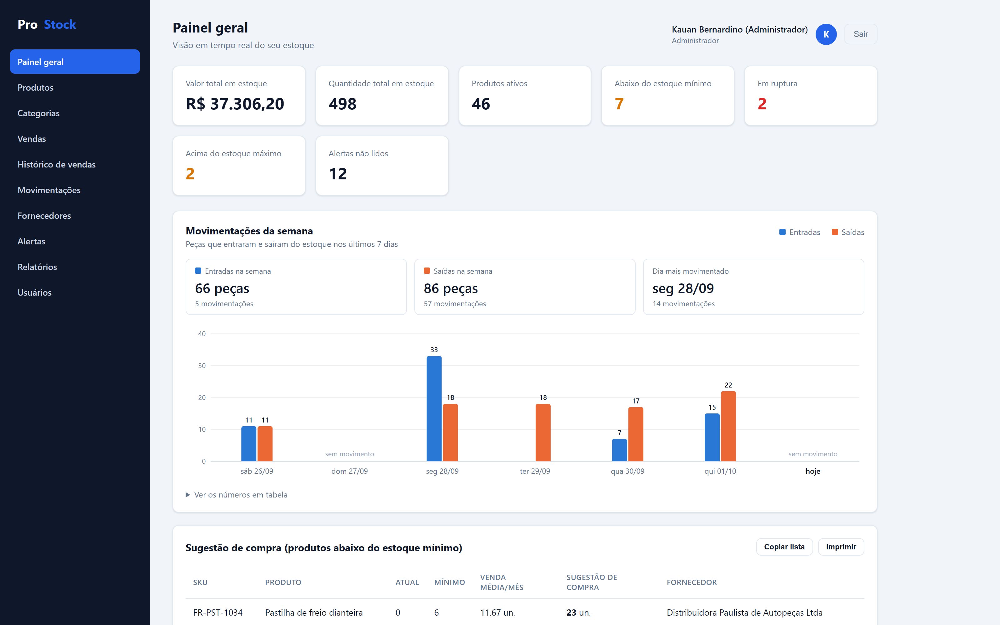
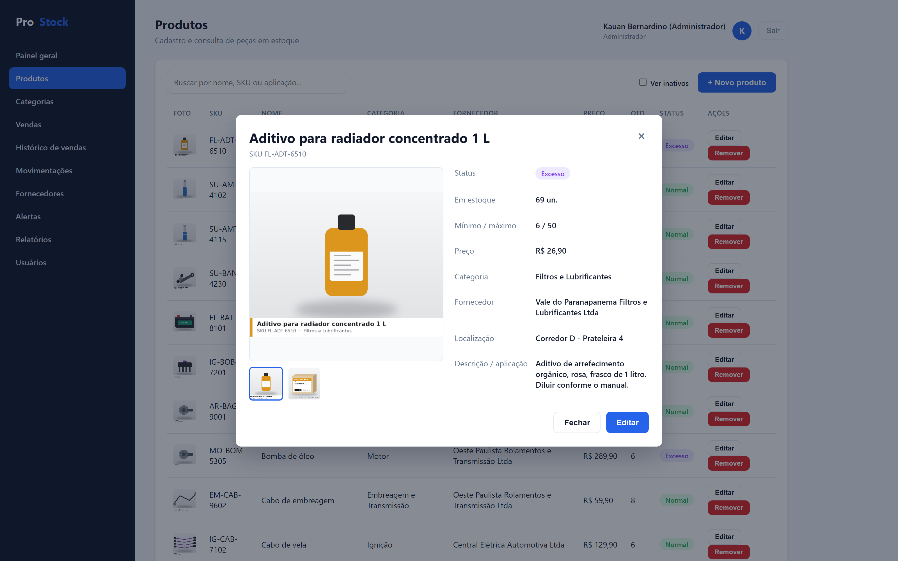
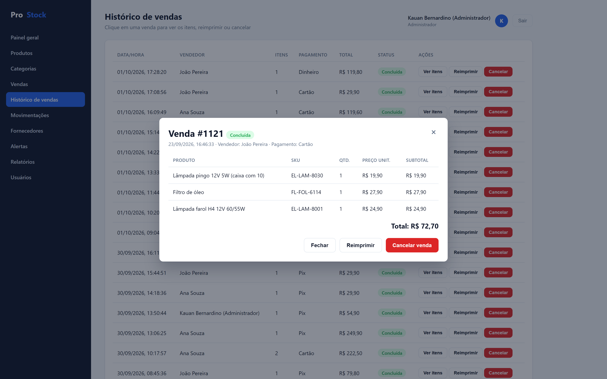
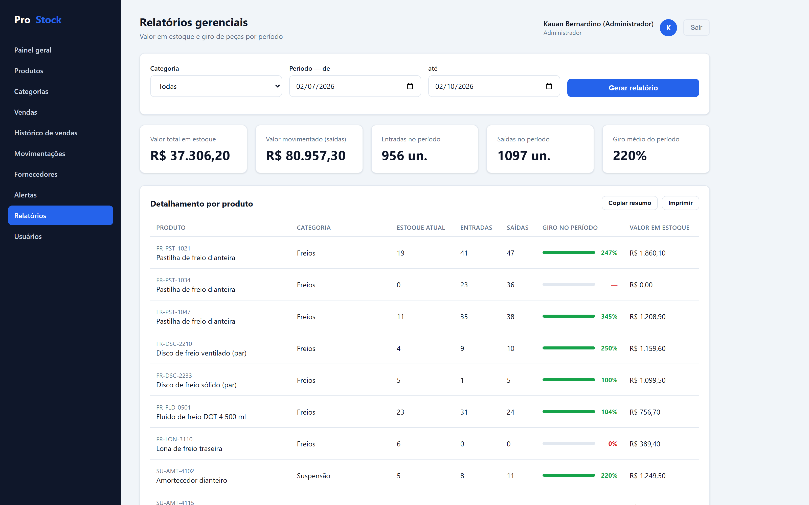
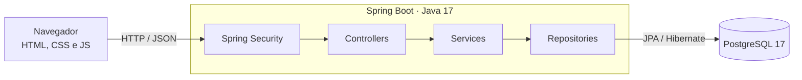

# ProStock

Sistema web de gestão de estoque para lojas de autopeças: controla produtos, entradas e saídas, avisa sozinho quando uma peça acaba, fica baixa, passa do máximo ou para de vender, e sugere quanto comprar com base nas vendas dos últimos meses. Inclui venda de balcão com Pix, cartão ou dinheiro.

Desenvolvido como Trabalho de Conclusão de Curso em Análise e Desenvolvimento de Sistemas (FEMA, 2026), a partir da observação do dia a dia de uma loja de autopeças.

   

| Painel geral | Detalhes do produto |
|---|---|
|  |  |
| **Histórico de vendas** | **Relatório gerencial** |
|  |  |

## Funcionalidades

- **Cadastros** de produtos (com até 6 fotos), categorias, fornecedores e usuários.
- **Movimentações de estoque**: toda entrada ou saída é registrada com motivo, usuário e data; a quantidade nunca é alterada sem deixar rastro.
- **Alertas automáticos** de ruptura, estoque baixo e excesso, avaliados a cada movimentação; estoque obsoleto verificado por rotina diária.
- **Sugestão de compra** pela demanda média dos últimos 3 meses, cobrindo 2 meses de venda dentro dos limites de mínimo e máximo.
- **Venda de balcão** com Pix (código "copia e cola" no padrão do Banco Central), cartão ou dinheiro; cancelamento devolve o estoque.
- **Busca de peças** por nome, SKU ou aplicação do veículo (ex.: `cabo vela gol 1997`).
- **Ajuste de inventário** pela contagem física, registrado como movimentação.
- **Relatório gerencial** de valor em estoque e giro por produto e período.
- **Dois perfis de acesso**: Administrador e Funcionário.

## Destaques técnicos

- **Arquitetura em camadas** (controller, service, repository) com API REST e frontend em HTML, CSS e JavaScript puro, servido pelo próprio Spring Boot.
- **Venda atômica**: o estoque de todos os itens é conferido antes de confirmar, dentro de uma transação; se um item falhar, nada é baixado.
- **Lock otimista** (`@Version`): duas vendas simultâneas da última unidade não passam ao mesmo tempo; a segunda recebe 409 sem gravar nada.
- **Segurança com Spring Security**: login por sessão (persistida no banco com Spring Session JDBC), senhas com BCrypt, proteção CSRF e autorização por cargo conferida no servidor.
- **Integridade em duas camadas**: as regras são validadas nos services e reforçadas no banco com `CHECK`, `UNIQUE` e chaves estrangeiras.
- **137 testes automatizados** (JUnit 5, Mockito e MockMvc): regras de negócio, endpoints e permissões, e a consulta de busca em banco H2.
- **Banco de demonstração** com 7 meses de operação simulada, gerado por scripts próprios e criado automaticamente na primeira execução.



## Tecnologias

| Camada | Tecnologia |
|---|---|
| Backend | Java 17, Spring Boot 3.3 (Web, Data JPA, Security, Validation), Spring Session JDBC, Lombok |
| Banco de dados | PostgreSQL 17, JPA/Hibernate |
| Frontend | HTML, CSS e JavaScript, sem framework |
| Testes | JUnit 5, Mockito, MockMvc, H2 |
| Ferramentas | Maven, Git, IntelliJ IDEA |

## Como rodar a demonstração

Pré-requisitos: **JDK 17**, **Maven 3.9+** (ou o IntelliJ) e **PostgreSQL 17** com usuário `postgres` e senha `postgres`.

```bash
git clone https://github.com/kauanbernardino/ProStock.git
cd ProStock
mvn spring-boot:run "-Dspring-boot.run.main-class=com.prostock.demo.ProStockDemoApplication"
```

Na primeira execução, o banco `prostock_demo` é criado e populado sozinho. Acesse **http://localhost:8080** com um dos usuários:

| E-mail | Senha | Perfil |
|---|---|---|
| admin@prostock.com | admin123 | Administrador |
| ana.souza@prostock.com | func123 | Funcionário |

No IntelliJ, use as configurações de execução **ProStock DEMO** ou **ProStock DEMO (recriar dados)**, que gera os dados de novo com as datas de hoje. Se a senha do `postgres` for outra, defina a variável de ambiente `DB_PASSWORD`.

## Testes

```bash
mvn test
```

Os testes não precisam do PostgreSQL: os services usam dublês (Mockito), os controllers rodam com MockMvc e a busca usa um banco H2 em memória.

## Estrutura do projeto

```
src/main/java/com/prostock/
├── controller/   endpoints REST
├── service/      regras de negócio
├── repository/   consultas Spring Data JPA
├── model/        entidades JPA (tabelas do banco)
├── dto/          objetos de requisição e resposta da API
├── security/     autenticação
├── exception/    tratamento centralizado de erros
├── config/       segurança, rotinas agendadas e inicialização
└── demo/         criação do banco de demonstração

src/main/resources/
├── application.yml
├── db/atualizacoes.sql   alterações de schema aplicadas na inicialização
└── static/               frontend (HTML, CSS e JS)

database/schema.sql       schema completo do PostgreSQL (10 tabelas + sessões)
ferramentas/demo/         geradores dos dados e das fotos de demonstração
```

## Rodando com o banco de uso real

**1. Criar o banco e aplicar o schema**

```bash
createdb prostock
psql -d prostock -f database/schema.sql
```

**2. Rodar a aplicação**

```bash
mvn spring-boot:run
```

Na primeira execução, se não houver usuários, é criado o administrador `admin@prostock.com` / `admin123`. Troque essa senha pela tela de usuários.

### Variáveis de ambiente

| Variável | Padrão | Para quê |
|---|---|---|
| `SPRING_DATASOURCE_URL` | `jdbc:postgresql://localhost:5432/prostock?currentSchema=prostock` | Conexão com o banco |
| `DB_USERNAME` / `DB_PASSWORD` | `postgres` / `postgres` | Credenciais do banco |
| `UPLOAD_DIR` | `./uploads` | Pasta das fotos de produto |
| `PIX_CHAVE` | `00000000000` | Chave Pix da loja |
| `PIX_NOME_RECEBEDOR` | `ProStock Autopecas` | Nome exibido no código Pix |
| `PIX_CIDADE` | `SAO PAULO` | Cidade exibida no código Pix |
| `CRON_OBSOLESCENCIA` | `0 0 7 * * *` | Horário da verificação diária de estoque obsoleto |

Os dados reais do Pix não ficam no repositório: defina-os por variável de ambiente ou no arquivo `config/application.properties` na raiz do projeto, que é ignorado pelo Git:

```properties
app.pix.chave=+5500000000000
app.pix.nome-recebedor=Nome do Recebedor
app.pix.cidade=CIDADE
```

Alterações de schema feitas depois da primeira versão ficam em `src/main/resources/db/atualizacoes.sql` e são aplicadas automaticamente a cada inicialização.

## Autor

**Kauan Bernardino da Silva**: Trabalho de Conclusão de Curso em Análise e Desenvolvimento de Sistemas, Fundação Educacional do Município de Assis (FEMA), 2026.
